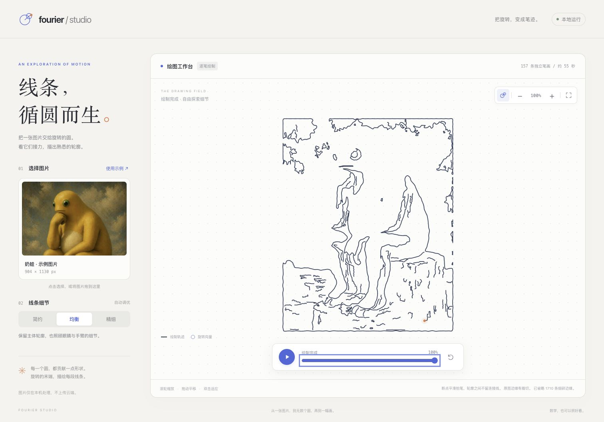

<div align="center">

# Fourier Studio

### 线条，循圆而生。

把一张图片交给旋转的圆，看它们逐笔描出熟悉的轮廓。

**Rust 图像计算 · Canvas 动画 · 本地运行**

[快速开始](#快速开始) · [使用指南](#使用指南) · [工作原理](#工作原理) · [开发与验证](#开发与验证)

</div>

---

Fourier Studio 是一个在本机运行的傅里叶绘图工作台。导入 PNG 或 JPEG，Rust 将图像拆成独立笔画并计算傅里叶系数，浏览器再用旋转圆链将它们逐笔绘出。笔画之间平滑抬笔，保留眼睛、肚皮、外轮廓等线条各自的位置。



## 功能亮点

| 功能 | 体验 |
| --- | --- |
| 图片转笔画 | 提取外轮廓与内部颜色边界，支持开放线条和闭合轮廓 |
| 三档细节 | 简约、均衡、精细，自动组合提取与采样参数 |
| 逐笔绘制 | 按邻近端点安排笔画，抬笔时沿平滑曲线移动 |
| 自由播放 | 播放、暂停、重播，拖动时间轴查看任意时刻 |
| 交互画布 | 滚轮缩放、拖动平移，支持触控板与双指手势 |
| 本地处理 | 服务仅监听本机，上传的图片在内存中计算 |
| 单一程序 | 网页资源嵌入 Rust 二进制，无需前端构建工具 |

## 快速开始

准备好 Rust / Cargo 和现代浏览器，然后运行：

```sh
git clone https://github.com/Tz2H/Fourier.git
cd Fourier
cargo run --release --locked
```

在浏览器打开 **[127.0.0.1:8787](http://127.0.0.1:8787)**，内置奶蛙示例会自动加载。保持终端运行，按 `Ctrl+C` 停止服务。

> 首次构建需要下载依赖。推荐使用 release 模式，以加快图像处理和傅里叶分解。运行无需 Node.js、npm、WebAssembly 工具或外部 CDN。

<details>
<summary><strong>更换端口或单独构建</strong></summary>

macOS / Linux：

```sh
FOURIER_PORT=8788 cargo run --release --locked
```

Windows PowerShell：

```powershell
$env:FOURIER_PORT = "8788"
cargo run --release --locked
```

随后打开 [127.0.0.1:8788](http://127.0.0.1:8788)。

只生成可执行文件：

```sh
cargo build --release --locked
```

产物位于 `target/release/fourier`，Windows 下为 `target/release/fourier.exe`。网页与示例图片已嵌入程序；修改 `web/` 下的资源后，需要重新构建并重启服务。

</details>

## 使用指南

1. **选择图片**：点击图片卡片或拖入 PNG / JPEG；点击「使用示例」恢复奶蛙。
2. **选择细节**：简约突出主体轮廓；均衡兼顾外形与内部线条；精细保留更多柔和边界。
3. **观看绘制**：播放、暂停或重新绘制，拖动进度条可定位到任意时刻，最右端显示完整图案。
4. **探索画布**：缩放、平移或隐藏辅助圆，查看局部笔画与旋转向量。

### 画布操作

| 操作 | 效果 |
| --- | --- |
| 滚轮 / 触控板捏合 | 以指针位置为中心缩放，范围 25%–1200% |
| 鼠标拖动 / 单指拖动 | 平移画布 |
| 触屏双指操作 | 捏合缩放并平移 |
| `+` / `−` 按钮或按键 | 放大 / 缩小 |
| 百分比 / 适应按钮 / 双击 / `0` | 居中并完整显示图案 |
| 方向键 | 平移视图 |
| 空格 | 播放 / 暂停 |

键盘操作需先让画布获得焦点。缩放和平移只改变视图，不改变计算结果或播放进度；100% 表示根据实际图案边界适应画布。系统开启「减少动态效果」时，关闭平滑缩放并等待手动播放。

## 工作原理

```text
PNG / JPEG
    ↓
解码与缩放 → 灰度分割 + 多通道颜色边缘
    ↓
轮廓提取 → 细化与独立笔画追踪 → 邻近端点排序
    ↓
统一坐标 → 按弧长采样 → 逐笔复数 DFT
    ↓
旋转向量 + 重建轨迹 + 抬笔时间轴
    ↓
浏览器 Canvas 逐笔绘制
```

每条笔画由一组旋转向量叠加得到：

$$
z(t) = z_0 + \sum_k A_k e^{i(2\pi f_k t + \varphi_k)}
$$

其中，$z_0$ 是笔画原点，$A_k$ 是振幅，$f_k$ 是频率，$\varphi_k$ 是初始相位。

- **独立笔画**：每条路线分别计算傅里叶系数，绘制时保持原有位置。
- **开放路线**：通过原路往返扩展为周期信号，只绘制前半周期；闭合路线绘制完整周期。
- **平滑抬笔**：从最长笔画开始，按邻近端点安排后续笔画；笔尖沿三次贝塞尔曲线移动，过渡不留下连接线。
- **自然节奏**：重建轨迹按弧长推进，五次缓动控制收笔与落笔，旋转圆随过渡淡入淡出。

Rust 负责图像提取、DFT 与时间轴生成；浏览器负责播放、插值、手势和渲染。

### 输入与性能

| 项目 | 限制或行为 |
| --- | --- |
| 文件格式 | PNG、JPEG |
| 文件大小 | 最大 32 MB |
| 解码限制 | 每边最多 12000 像素，分配预算 128 MB |
| 工作图像 | 最长边缩至 768 像素，透明区域合成到白色 |
| 内部细节 | 过滤短噪声，最多保留 128 条内部笔画 |
| 计算方式 | 直接 DFT；精细档通常耗时更长 |
| 请求处理 | 串行计算，限制多张大图同时处理的内存开销 |

这是基于图像边缘的重建。阴影和纹理可能成为线条，缺少亮度或颜色差异的边界可能无法提取。被遮挡的部分不会自动补全；内置示例底部存在裁切，界面会提示。

## 项目结构

```text
Fourier/
├── src/
│   ├── main.rs              # 本机网页服务入口
│   ├── lib.rs               # 模块导出
│   ├── web/                 # HTTP、上传、预设与抬笔时间轴
│   ├── image_processing/    # 解码、分割、边缘与笔画追踪
│   ├── math/                # 采样、DFT 与笔画排序
│   ├── animation/           # 重建轨迹与播放模型
│   └── desktop/             # 可选原生桌面模块
├── web/
│   ├── index.html           # 中文界面与无障碍标签
│   ├── style.css            # 自适应布局与视觉设计
│   ├── app.js               # 上传、播放与 Canvas 渲染
│   ├── viewport.js          # 缩放、平移与坐标变换
│   └── playback.js          # 时间轴、弧长重映射与断点缓动
├── docs/preview.png         # 实际界面预览
├── tests/                   # 旋转向量与动画状态测试
├── Cargo.toml
├── Cargo.lock
└── images.jpeg              # 内置示例
```

默认入口为本机网页服务。`desktop` feature 可编译原生桌面模块，当前 `main.rs` 仍启动网页服务。

## 开发与验证

```sh
# 检查 Rust 格式
cargo fmt --all -- --check

# 运行测试，同时编译可选桌面模块
cargo test --locked --all-features

# 构建默认网页程序
cargo build --release --locked
```

`Cargo.lock` 随源码提交，以固定依赖解析结果；构建产物 `target/` 由 Git 忽略。
